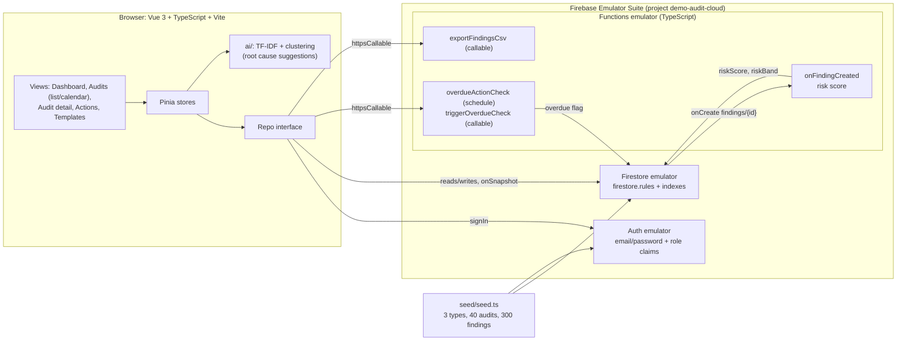

# audit-cloud-lab

Audit management platform built with Vue 3 and Firebase, running only on the local Firebase Emulator Suite.
Plan audits in a list or calendar, work through checklists on site, record findings with small photos,
track corrective actions with owners and due dates, and see deviation statistics on a dashboard.
A local TF-IDF helper groups similar findings and suggests recurring root causes.

## Architecture



| Folder | Content |
|---|---|
| `web/` | Vue 3 + TypeScript + Vite + Pinia + Vue Router app. Mobile first, keyboard accessible (skip link, labelled forms, 44 px touch targets, live regions). |
| `firebase/` | Firestore security rules (role claims, field validation, server-only fields) and composite indexes. `firebase.json` configures the emulators. |
| `functions/` | Cloud Functions v2 in TypeScript: `onFindingCreated`, scheduled `overdueActionCheck`, callable `triggerOverdueCheck` and `exportFindingsCsv`. Bundled with esbuild. |
| `shared/` | Domain logic used by app, functions and seed: risk score, CSV export with formula injection guard, stats, calendar grid, validation, seeded generator. |
| `ai/` | Deterministic TF-IDF (words plus character 4-grams) and average-linkage clustering, root cause naming, labeled evaluation (`ai/eval/`). No external API. |
| `seed/` | Seeds the emulators: 3 audit types, 40 audits, 300 findings, corrective actions and 3 demo users. |
| `tests/` | Vitest unit and component tests, Firestore rules tests with `@firebase/rules-unit-testing`. |
| `e2e/` | Playwright end-to-end tests against the emulators. |
| `perf/` | Bundle size budget and Lighthouse CI configuration. |
| `docs/` | Data model and runbook. |

## Quick start

```bash
npm ci
npm run emulators          # terminal 1: auth, firestore, functions on 127.0.0.1
FIRESTORE_EMULATOR_HOST=127.0.0.1:8080 FIREBASE_AUTH_EMULATOR_HOST=127.0.0.1:9099 npm run seed   # terminal 2
npm run dev                # open http://127.0.0.1:5173, sign in as auditor@demo.test / demo-password
```

Needs Node.js 22 and Java 21. No Google account, no `firebase login`, no keys: the `demo-` project id keeps everything local.
More commands in [docs/runbook.md](docs/runbook.md).

## Results

RESULTS_TABLE

## Honest section

- Everything runs on the Firebase Emulator Suite with the demo project `demo-audit-cloud`. Nothing was deployed to a real Google Cloud or Firebase project, so there are no production latency, cost or quota numbers.
- All data is synthetic: generated by a seeded generator (`shared/seedData.ts`). The labeled clustering set (63 findings, 7 root causes) was written by hand for this repo and is small.
- The clustering helper is a plain TF-IDF baseline. On held-out data it is clearly weaker than on the full set (see results), and its suggestions are hints, not answers.
- Photos are stored as small data URLs in Firestore documents to stay emulator only. A real system should use Cloud Storage.
- The scheduled `overdueActionCheck` is not fired by the emulator setup (no Pub/Sub emulator). The same logic runs through the callable `triggerOverdueCheck`, which the e2e test uses.
- Lighthouse audits only the public sign-in page, because other routes need a signed-in session.
- `npm run e2e:offline` runs the same Playwright suite against an in-browser backend (`VITE_BACKEND=memory`). It is a convenience for machines without Java; the emulator run in CI is the real test.
